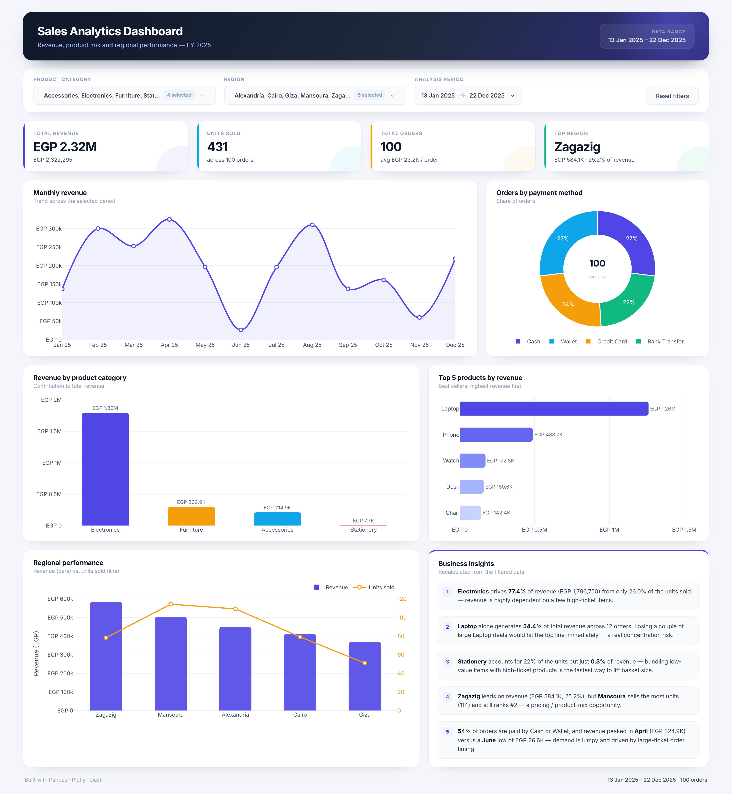
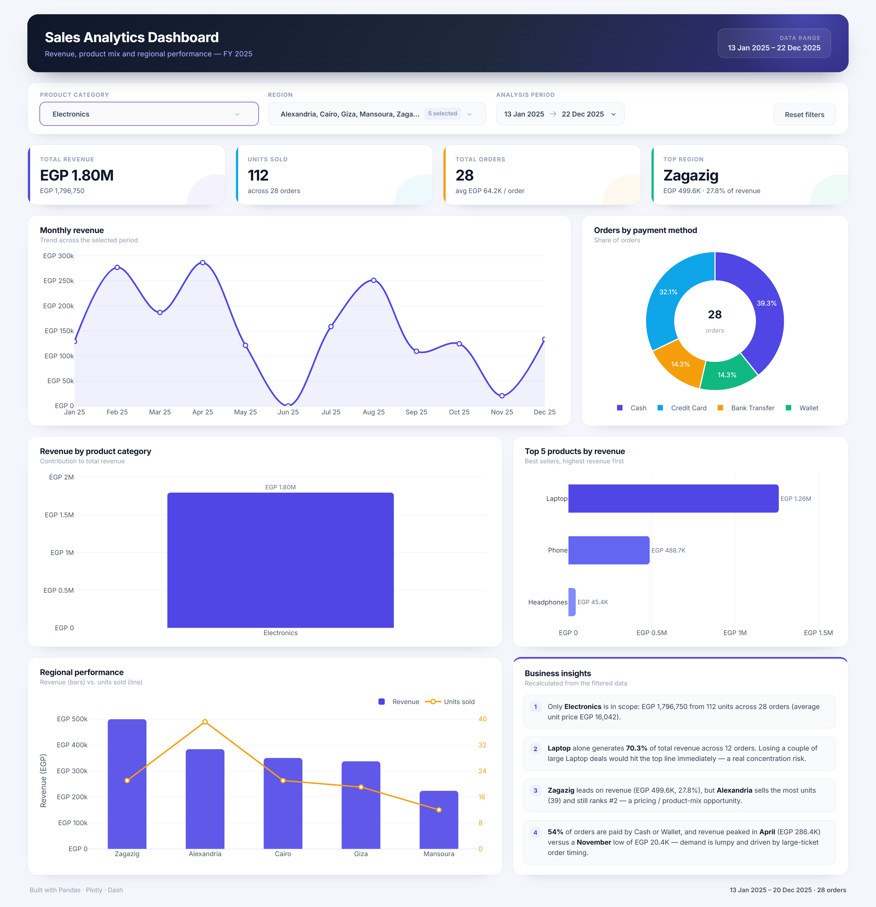
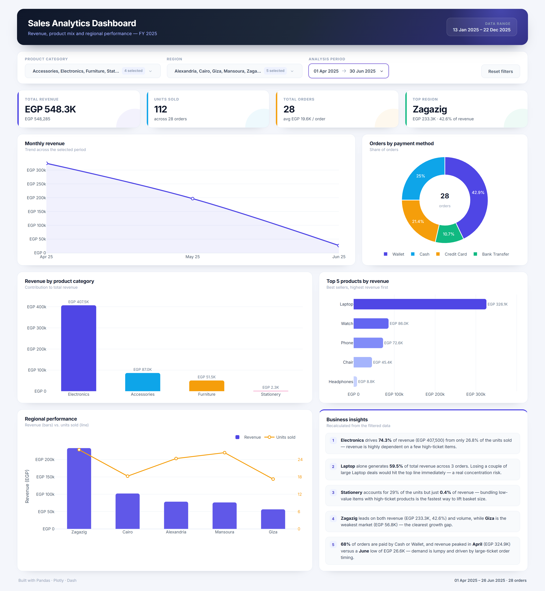
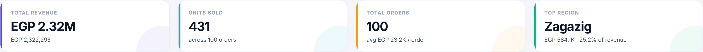

# 📊 Sales Analytics Dashboard — Dash + Plotly

An interactive sales analytics dashboard built with **Pandas**, **Plotly** and **Dash**.
It turns a raw 100-order sales export into a live view of revenue, product mix,
regional performance and payment behaviour — every chart and KPI reacts to the
filters in real time.



---

## ✨ Features

| Area | What it does |
|------|--------------|
| **Data prep** | Loads the CSV with Pandas, parses `Date`, and derives `Revenue = Quantity × Unit_Price` |
| **KPI cards** | Total revenue, units sold, total orders and the top-performing region (all recomputed per filter) |
| **Filters** | Multi-select **product category**, multi-select **region**, and a **date-range** picker for the analysis period |
| **Charts** | Monthly revenue line, revenue by category, orders by payment method (donut), top 5 products (horizontal bars), regional revenue vs. units |
| **Dynamic insights** | 4–5 business insights are recalculated from the *filtered* slice on every change |
| **Reset** | One click restores all filters to the full year |

### Interactive filters in action

| Electronics only | Q2 2025 date range |
|---|---|
|  |  |

<p align="center">
  
</p>

---

## 🗂 Project structure

```
sales-analytics-dashboard/
├── app.py                      # Dashboard: data prep, Plotly figures, layout, callbacks
├── assets/
│   └── style.css               # Custom dashboard theme
├── sales_dashboard_task.csv    # Dataset (100 orders, 2025)
├── screenshots/                # Final dashboard screenshots
│   ├── 01_dashboard_full.png
│   ├── 02_kpi_cards.png
│   ├── 03_filtered_electronics.png
│   └── 04_date_filtered_q2.png
├── take_screenshots.py         # Optional: regenerates the screenshots with Playwright
├── requirements.txt
└── README.md
```

---

## 📁 Dataset

`sales_dashboard_task.csv` — 100 orders placed between **13 Jan 2025** and **22 Dec 2025**.
No missing values, no duplicate order IDs.

| Column | Type | Description |
|---|---|---|
| `Order_ID` | text | Unique order identifier (`ORD-0001` …) |
| `Date` | date | Order date (parsed to `datetime`) |
| `Product` | text | 10 products |
| `Category` | text | Electronics, Furniture, Accessories, Stationery |
| `Quantity` | int | Units per order (1–8) |
| `Unit_Price` | int | Price per unit in EGP |
| `Region` | text | Alexandria, Cairo, Giza, Mansoura, Zagazig |
| `Payment_Method` | text | Cash, Wallet, Credit Card, Bank Transfer |
| `Revenue` | int | **Derived:** `Quantity × Unit_Price` |

---

## 📈 Headline results (full year)

| Metric | Value |
|---|---|
| **Total revenue** | **EGP 2,322,295** |
| **Units sold** | **431** across 100 orders |
| **Average order value** | EGP 23,223 |
| **Top region** | Zagazig — EGP 584,115 (25.2% of revenue) |
| **Top category** | Electronics — EGP 1,796,750 (77.4% of revenue) |
| **Top product** | Laptop — EGP 1,262,650 (54.4% of revenue) |
| **Peak month** | April — EGP 324,885 |

### Revenue by category

| Category | Revenue (EGP) | Share | Units | Share of units |
|---|---:|---:|---:|---:|
| Electronics | 1,796,750 | 77.4% | 112 | 26.0% |
| Furniture | 302,950 | 13.0% | 84 | 19.5% |
| Accessories | 214,945 | 9.3% | 141 | 32.7% |
| Stationery | 7,650 | 0.3% | 94 | 21.8% |

### Revenue by region

| Region | Revenue (EGP) | Share | Units | Orders |
|---|---:|---:|---:|---:|
| Zagazig | 584,115 | 25.2% | 78 | 18 |
| Mansoura | 504,190 | 21.7% | 114 | 27 |
| Alexandria | 450,435 | 19.4% | 109 | 24 |
| Cairo | 413,035 | 17.8% | 79 | 18 |
| Giza | 370,520 | 16.0% | 51 | 13 |

### Top 5 products by revenue

| Product | Revenue (EGP) | Units | Orders |
|---|---:|---:|---:|
| Laptop | 1,262,650 | 50 | 12 |
| Phone | 488,700 | 34 | 9 |
| Watch | 172,850 | 73 | 16 |
| Desk | 160,550 | 33 | 8 |
| Chair | 142,400 | 51 | 12 |

---

## 💡 Business insights

**1. The business is dangerously dependent on laptops.**
A single product — **Laptop** — generates **54.4%** of total revenue (EGP 1,262,650)
from just 12 orders, and **Electronics** as a category contributes **77.4%** of revenue.
Losing a couple of large laptop deals would visibly hit the top line.
*Action:* build a second revenue pillar (phone bundles, furniture financing) and set
account-management targets for the top 10 laptop buyers.

**2. Revenue comes from price, not volume — the long tail is under-monetised.**
Electronics is 26% of the units but 77.4% of the revenue, while **Accessories +
Stationery are 54.5% of the units but only 9.6% of the revenue**. The cheap items
move, but they barely pay for themselves.
*Action:* bundle accessories (backpack, headphones, watch) with every laptop/phone
order and introduce a minimum-order threshold — this raises basket size without
touching unit prices.

**3. Regional leadership differs by revenue vs. volume.**
**Zagazig** is the top market by revenue (EGP 584,115, 25.2%) with only 18 orders —
i.e. the highest average basket. **Mansoura** sells the most units (114, +46% vs
Zagazig) but ranks second on revenue, so its mix is skewed toward cheaper products.
*Action:* replicate Zagazig's premium product mix in Mansoura (upsell laptops/desks
there) instead of discounting; Giza (EGP 370,520) is the clearest growth gap.

**4. Demand is lumpy and large-ticket driven.**
Monthly revenue swings from **EGP 324,885 in April** to **EGP 26,630 in June** —
a 92% drop — because a handful of laptop orders dominate each month. Averages are
therefore misleading for planning.
*Action:* forecast on order-level pipeline, keep 2–3 months of stock buffer for
high-ticket SKUs, and smooth cash flow with instalments in weak months.

**5. Payment methods are evenly spread; cash + wallet dominate.**
Cash (27) and Wallet (27) together cover **54% of orders**, ahead of Credit Card (24)
and Bank Transfer (22).
*Action:* protect the cash-on-delivery experience (this is the majority of customers)
while pushing wallet promotions, which are cheaper to process than COD.

> All insights on the dashboard are generated **dynamically from the filtered data**,
> so they stay valid when the user narrows the period, category or region.

---

## 🚀 Run it locally

```bash
# 1) (optional) create a virtual environment
python -m venv .venv
.venv\Scripts\activate        # Windows
# source .venv/bin/activate   # macOS / Linux

# 2) install dependencies
pip install -r requirements.txt

# 3) start the dashboard
python app.py
```

Then open **http://127.0.0.1:8050**.

### Regenerate the screenshots (optional)

```bash
pip install playwright
python take_screenshots.py     # requires the app to be running on port 8050
```

---

## ⚙️ How it works

1. **`load_data()`** reads the CSV once, converts `Date` with `pd.to_datetime`
   and creates `Revenue`.
2. **`apply_filters()`** slices the dataframe by category, region and date range.
3. Five figure builders (`monthly_revenue_figure`, `category_figure`,
   `payment_figure`, `top_products_figure`, `region_figure`) take the filtered
   dataframe and return a Plotly figure — so the charts never read stale state.
4. **`kpi_values()`** and **`build_insights()`** compute the cards and the insight
   text from the same slice.
5. A single Dash callback binds the four filter inputs to all outputs
   (KPI row, 5 graphs, insights list, footer period), and a second callback powers
   the **Reset filters** button.

```
Filters ──▶ callback ──▶ filtered df ──▶ KPIs + 5 Plotly figures + insights
```

---

## 🛠 Tech stack

- **Python 3.11**
- **Pandas** — data loading, aggregation, time-series resampling
- **Plotly** — line / bar / donut / horizontal bar charts
- **Dash** — layout, dropdown & date-range filters, reactive callbacks
- **CSS** — custom responsive theme (no UI framework)

---

## 👤 Author

**Mahmoud Abdo Hassan**
GitHub: [@MahmoudAbd0o](https://github.com/MahmoudAbd0o)
